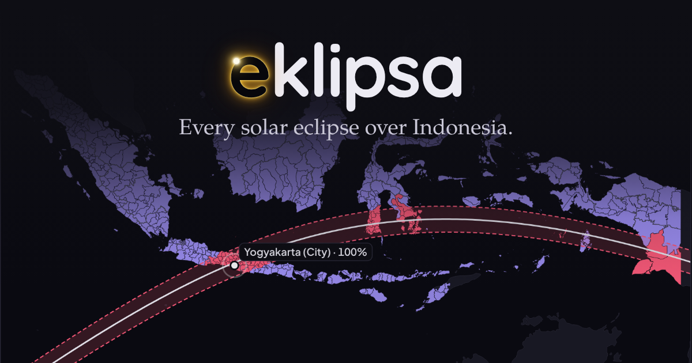

# eklipsa



**Every solar eclipse over Indonesia.**
*Setiap gerhana matahari di Indonesia.*

eklipsa is an interactive map of the solar eclipses visible from each of Indonesia's 514 regencies and cities (kabupaten/kota), from 1945 to 3000 AD.

🔗 **Live site:** https://eklipsa.vercel.app <!-- replace with your Vercel URL -->

<!-- Optional: add a screenshot

-->

---

## Features

- **514 regencies and cities.** Search for one or tap it on the map. A city (kota) is labelled *(City)* / *(Kota)*.
- **617 eclipses, 1945–3000.** Every solar eclipse whose shadow reaches Indonesia, split into past and upcoming.
- **Type and coverage per place.** Each eclipse shows whether it is total, annular or partial at that place, and what percentage of the Sun is covered.
- **Map of each eclipse.**
  - Every region is shaded by how much of the Sun it loses.
  - Total and annular areas are highlighted.
  - The path of totality or annularity is drawn with its centre line.
- **Local details.**
  - Start, peak and end times in WIB / WITA / WIT, plus UTC.
  - How long totality or annularity lasts, magnitude, and the Sun's height at peak.
  - Saros series number.
  - A drawing of the Sun at peak.
- **Timeline.** All eclipses for the selected place from 1945 to 3000 at a glance.
- **Filter and sort.** Filter by Upcoming / Past / All and by type (Total, Annular, Partial). Sort by date or by coverage.
- **English and Bahasa Indonesia**, plus **light and dark mode**.
- **Works on phone, tablet and desktop.**
- **Shareable links.** For example `/#kk-3471` opens Yogyakarta (City).

## How it works

- **Eclipse list.** The global solar eclipses from 1945 to 3000 were computed with [Astronomy Engine](https://github.com/cosinekitty/astronomy). For each one, *Besselian elements* (the standard numbers that describe the Moon's shadow over time) were fitted.
- **Local details in the browser.** The page uses those numbers to work out each place's local details on the spot: contact times, magnitude, coverage, type and the Sun's height.
- **Paths on the map.** The path of totality or annularity is found by projecting the Moon's shadow onto Earth's surface.
- **Checked against known eclipses**, for example:
  - 1983 total, Yogyakarta: about 5 minutes of totality.
  - 2016 total, Palu.
  - 2019 annular, Singkawang.
  - 2023 hybrid, Biak.

The whole site is a **single self-contained `index.html`**. Data and libraries are built in; only the fonts load from Google Fonts.

## Run locally

No build step is needed. Open `index.html` in a browser, or serve the folder:

```bash
python3 -m http.server 8000
# then open http://localhost:8000
```

## Deploy (Vercel)

1. Push this repository to GitHub.
2. In Vercel, choose **Add New → Project** and import the repository.
3. Set **Framework Preset** to *Other*. Leave the build command and output directory empty.
4. Deploy. Every push to the production branch redeploys the site automatically.

## Disclaimer

- **Range:** currently limited to solar eclipses from 1945 up to **3000 AD**.
- **Location:** figures are calculated for one central point of each regency or city. The edges of large regencies may see different coverage.
- **Far future:** eclipses after about 2200 depend on predictions of Earth's slowing rotation (ΔT), so their times, paths and percentages are indicative only.
- **Time zones:** times use today's zones (WIB UTC+7, WITA UTC+8, WIT UTC+9), not the zones in force in earlier decades.
- **Not for safety decisions.** Never look at the Sun without proper eclipse glasses or a solar filter.

## Sources and credits

| What | Source |
|---|---|
| Eclipse calculations | [Astronomy Engine](https://github.com/cosinekitty/astronomy) by Don Cross (MIT) |
| Regency and city boundaries | Kemendagri 2023, via [Alf-Anas/batas-administrasi-indonesia](https://github.com/Alf-Anas/batas-administrasi-indonesia), simplified |
| Neighbouring countries | [Natural Earth](https://www.naturalearthdata.com/) via [world-atlas](https://github.com/topojson/world-atlas) |
| Map rendering | [D3](https://d3js.org/) and [topojson-client](https://github.com/topojson/topojson-client) (ISC) |
| Fonts | [Plus Jakarta Sans](https://fonts.google.com/specimen/Plus+Jakarta+Sans) and [Quicksand](https://fonts.google.com/specimen/Quicksand) (SIL OFL); Palatino from the device |

## License

<!-- Choose a license, e.g. MIT, and add a LICENSE file -->
To be decided.

---

Made by Rahmat Maulana Koto
